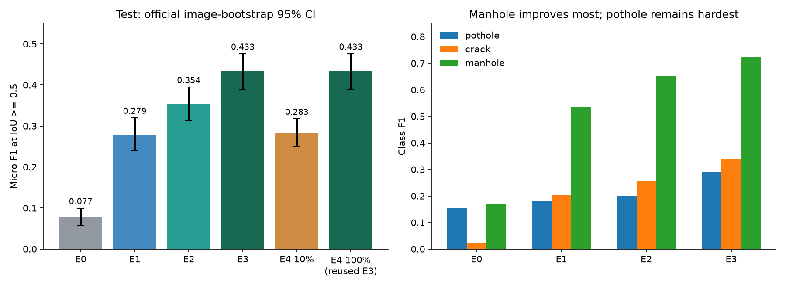
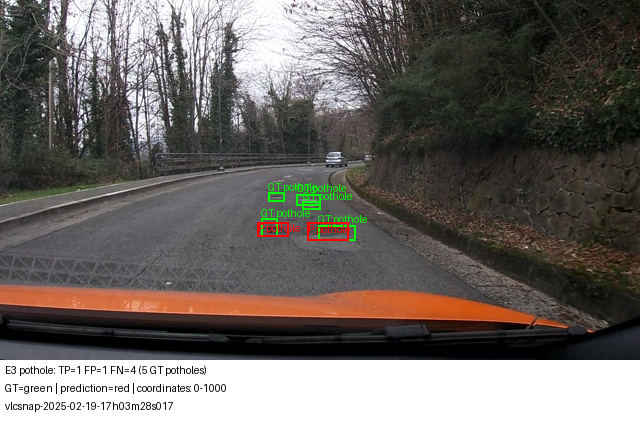
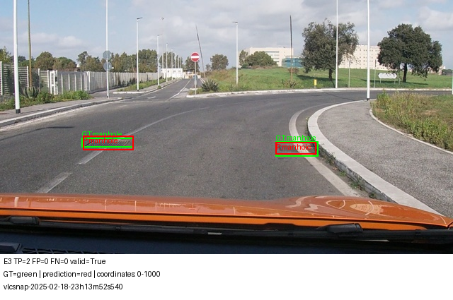
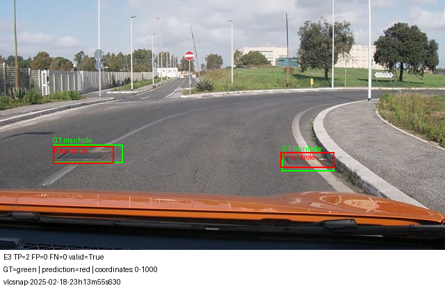
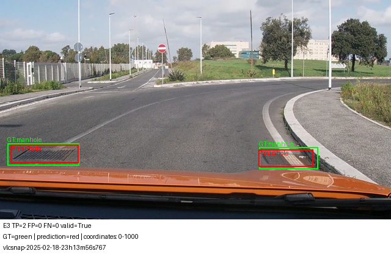
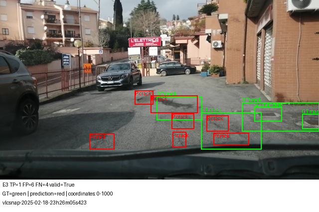
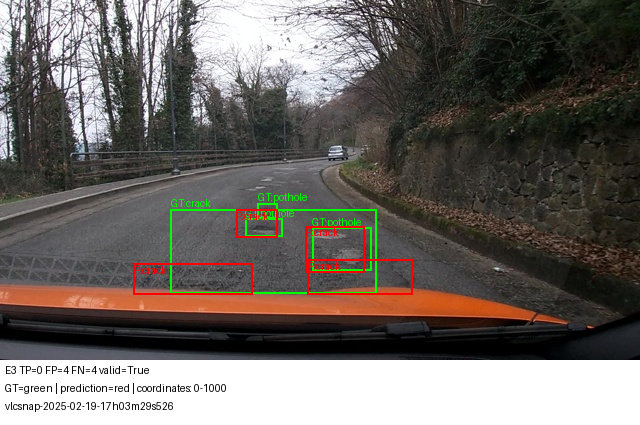
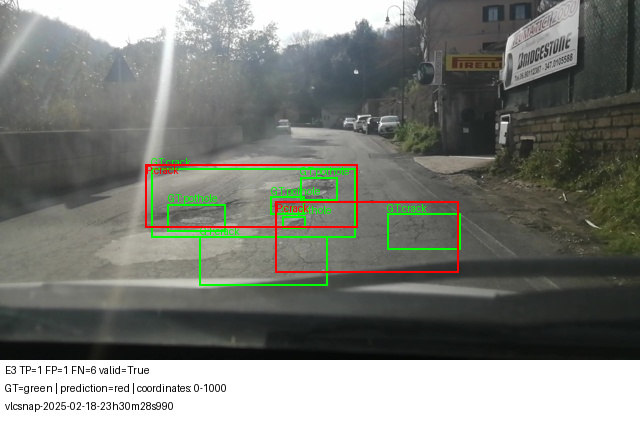
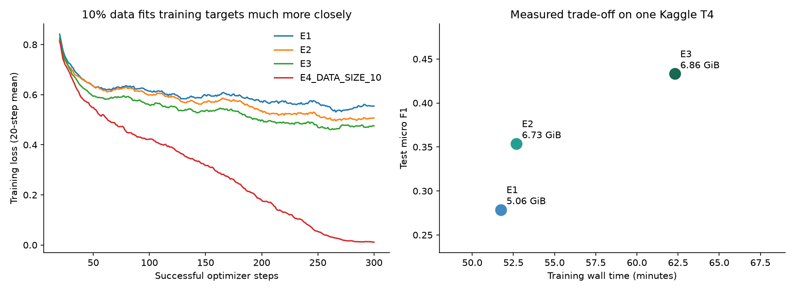

Họ tên: LuuQuangKhai
Mã học viên: 2A202602599
`dataset_version`: `d10-21e4070301`

# Báo cáo Lab Day 10 — QLoRA Qwen3-VL-4B cho hư hại mặt đường

## Thiết lập và nguồn bằng chứng

Thí nghiệm chạy trên Kaggle với Tesla T4; phiên có hai GPU nhưng mã chỉ sử dụng GPU 0.
Model là `Qwen/Qwen3-VL-4B-Instruct`, revision `ebb281ec70b05090aa6165b016eac8ec08e71b17`.
Môi trường: torch `2.11.0+cu128`, torchvision `0.26.0+cu128`, transformers `5.19.0`,
peft `0.21.2`, bitsandbytes `0.50.2`, accelerate `1.15.0`;
chi tiết ở [environment.json](report/environment.json).

LLM dùng NF4 4-bit, double quantization và compute dtype fp16; `visual` và `lm_head`
không lượng tử hóa. Các tham số trainable giữ fp32; forward dùng autocast fp16.
E1–E3 cùng rank 16, alpha 32, dropout 0,05, AdamW lr `2e-4`, weight decay 0,
warmup 15 bước rồi cosine, seed 42, gradient checkpointing `use_reentrant=False`.
Batch 1 và tích lũy gradient 8 giữ effective batch bằng 8 như đề. Mỗi lượt hoàn thành
300 bước optimizer; inference greedy, batch 2, `max_new_tokens=512`, cùng prompt.
So với cấu hình gợi ý, batch 2/accumulation 4 được đổi thành 1/8 và giới hạn sinh tăng
từ 256 lên 512. Những thay đổi này áp dụng nhất quán giữa các setup.

Mỗi lượt train khởi tạo độc lập từ model gốc. Đánh giá sau khi nạp lại adapter và
projector vào base mới. E4 chọn setup bằng toàn bộ validation, không chọn bằng test.
Không thực hiện E5/GRPO.

Nguồn số liệu là `lab_day10_results.zip`; mã nguồn thực chạy được lưu tại
[report/provenance](report/provenance). Chấm lại 10 cặp experiment/split từ output thô
bằng scorer gốc cho kết quả khớp, gồm cả CI95; mốc E4 100% được đối chiếu với E3.
Phân tích bổ sung tái tạo bằng `python analyze_results.py`; số liệu chi tiết ở
[verified_analysis.json](report/analysis/verified_analysis.json).

## Bảng tổng hợp

F1 là **micro F1 tại IoU ≥ 0,5**, yêu cầu đúng lớp và ghép một-một. CI95 trong bảng do
`scripts/score.py` sinh bằng bootstrap 1.000 lần theo ảnh, seed 0. Số thập phân được
làm tròn; file evidence giữ độ chính xác đầy đủ.

| Mã | Setup | Tham số huấn luyện | VRAM đỉnh (GiB) | Phút train | F1 | CI95 | FP/ảnh | F1 pothole | F1 crack | F1 manhole |
|---|---|---:|---:|---:|---:|---|---:|---:|---:|---:|
| E0 | Zero-shot | 0 | 3,6215 | 0 | 0,0775 | [0,0566; 0,0995] | 2,0354 | 0,1538 | 0,0231 | 0,1697 |
| E1 | LoRA LLM | 33.030.144 | 5,0643 | 51,7423 | 0,2787 | [0,2404; 0,3196] | 1,0643 | 0,1809 | 0,2029 | 0,5375 |
| E2 | E1 + full projector | 142.135.296 | 6,7255 | 52,6792 | 0,3537 | [0,3138; 0,3947] | 0,9389 | 0,2019 | 0,2575 | 0,6528 |
| E3 | E2 + LoRA ViT | 148.426.752 | 6,8609 | 62,2970 | 0,4332 | [0,3886; 0,4760] | 0,7653 | 0,2902 | 0,3380 | 0,7260 |
| E4 10% | E3, 142 ảnh train | 148.426.752 | 6,5884 | 61,6317 | 0,2833 | [0,2498; 0,3173] | 1,7492 | 0,1919 | 0,2263 | 0,5248 |
| E4 100% | E3, 1.422 ảnh train; dùng lại E3 | 148.426.752 | 6,8609 | 62,2970 | 0,4332 | [0,3886; 0,4760] | 0,7653 | 0,2902 | 0,3380 | 0,7260 |

Nguồn: [E0](report/evidence/e0.json), [E1](report/evidence/e1.json),
[E2](report/evidence/e2.json), [E3](report/evidence/e3.json),
[E4 10%](report/evidence/e4_data_size_10.json), [E4 100%](report/evidence/e4_data_size_100.json).
`peak_vram_gb` được đo bằng `max_memory_allocated()/2**30`, nên đơn vị thực là GiB,
chỉ phản ánh bộ nhớ tensor PyTorch được cấp phát. E0 đo đỉnh inference; E1–E4 đo đỉnh
train. Các số này không phải tổng VRAM theo `nvidia-smi`.

| Mã | Parse hợp lệ | TP | FP | FN | Phút suy luận val | Phút suy luận test |
|---|---:|---:|---:|---:|---:|---:|
| E0 | 90,997% | 49 | 633 | 534 | 35,9441 | 33,8406 |
| E1 | 99,357% | 148 | 331 | 435 | 22,7421 | 23,0104 |
| E2 | 100% | 188 | 292 | 395 | 20,9179 | 21,9977 |
| E3 | 100% | 227 | 238 | 356 | 20,8533 | 21,4779 |
| E4 10% | 100% | 186 | 544 | 397 | 31,4008 | 30,6781 |

Tổng train của bốn lượt là 228,35 phút; inference val/test của năm lượt là 262,86 phút.
Tổng các bộ đếm này là 491,21 phút, khoảng **8,19 giờ**, chưa gồm toàn bộ thời gian
tải/nạp model và thao tác chuẩn bị. E4 100% dùng lại E3, không tính hai lần.



## 10 câu hỏi

### Câu 1 — Kiến trúc: ViT, projector và LLM của Qwen3-VL-4B có bao nhiêu tham số mỗi khối, và E1/E2/E3 mỗi cái cập nhật khối nào?

Số đo trước khi gắn adapter, quy đổi trọng số 4-bit về số phần tử dense ban đầu:

| Khối | Tham số |
|---|---:|
| LLM, gồm embedding và các trọng số được đếm cùng khối này | 4.022.468.096 |
| ViT backbone, không gồm projector | 306.242.560 |
| `visual.merger` | 27.271.680 |
| `visual.deepstack_merger_list` | 81.833.472 |
| Tổng projector | 109.105.152 |
| Tổng model, không cộng trùng projector | 4.437.815.808 |

Nguồn: [architecture.json](report/resources/e0/architecture.json), danh sách tham số
[E2](report/resources/e2/trainable_parameters.json). Visual gồm backbone và projector
là 415.347.712 tham số. Không cộng một khối ViT 415M rồi cộng tiếp 109M projector vì
sẽ đếm trùng. `lm_head` không được đếm riêng trong thống kê `named_parameters` của
lượt chạy; số 0 ở trường đó không có nghĩa mô hình không có output head.

E1 cập nhật adapter trên 252 module attention/MLP LLM; trọng số nền, ViT và projector
đóng băng. E2 vẫn có 252 module LoRA nhưng mở toàn bộ hai nhóm projector, tăng đúng
**109.105.152** tham số trainable so với E1. E3 thêm 96 module attention/MLP ViT,
tổng 348 module LoRA; tăng **6.291.456** tham số adapter so với E2, không mở toàn bộ
ViT backbone. E3 cập nhật 148.426.752 tham số, khoảng 3,34% model gốc.

### Câu 2 — E0: `parse_valid_rate` bằng bao nhiêu, và hai lỗi phổ biến nhất của model gốc là gì (kèm một ví dụ output thô)?

E0 parse hợp lệ **283/311 ảnh = 90,997%**, nhưng F1 chỉ 0,0775. Hai dạng lỗi nổi bật
là box không khớp và sinh lặp làm hỏng/cắt JSON.

E0 có **633 FP**, gồm 471 crack; chỉ 9 crack khớp, precision crack là 0,0188.
Ví dụ `vlcsnap-2025-02-19-17h03m22s057`: model xuất 15 dải crack ngang toàn chiều
rộng trong khi GT có 3 object. Output thô đầy đủ:

```json
[{"label": "crack", "bbox_2d": [0, 700, 1000, 750]}, {"label": "crack", "bbox_2d": [0, 650, 1000, 700]}, {"label": "crack", "bbox_2d": [0, 600, 1000, 650]}, {"label": "crack", "bbox_2d": [0, 550, 1000, 600]}, {"label": "crack", "bbox_2d": [0, 500, 1000, 550]}, {"label": "crack", "bbox_2d": [0, 450, 1000, 500]}, {"label": "crack", "bbox_2d": [0, 400, 1000, 450]}, {"label": "crack", "bbox_2d": [0, 350, 1000, 400]}, {"label": "crack", "bbox_2d": [0, 300, 1000, 350]}, {"label": "crack", "bbox_2d": [0, 250, 1000, 300]}, {"label": "crack", "bbox_2d": [0, 200, 1000, 250]}, {"label": "crack", "bbox_2d": [0, 150, 1000, 200]}, {"label": "crack", "bbox_2d": [0, 100, 1000, 150]}, {"label": "crack", "bbox_2d": [0, 50, 1000, 100]}, {"label": "crack", "bbox_2d": [0, 0, 1000, 50]}]
```

Ví dụ này có TP=0, FP=15, FN=3;
[ảnh minh họa](report/figures/e0/4_vlcsnap-2025-02-19-17h03m22s057.png).
Không mặc định mọi FP đều là hallucination: FP cũng có thể do sai lớp hoặc sai IoU.
Riêng ví dụ lặp dải cho thấy grounding chưa hữu ích.

E0 có **28 output không parse được**; 27 output trong số đó chạm giới hạn 512 token.
Ở `vlcsnap-2025-02-18-23h08m17s021`, chuỗi kết thúc giữa box bằng
`{"label": "crack", "bbox_2d": [73`, không đóng JSON. Đây là bằng chứng về sinh dài/lặp
và bị cắt; chưa đo phần tiếp theo nếu tăng giới hạn. Có 20 output `[]`, 0 box nhãn
ngoài ba lớp và 1 box vượt [0,1000]. Không quy toàn bộ lỗi E0 cho sai tên lớp hay sai
thang tọa độ. Chi tiết ở [errors/e0.json](report/errors/e0.json).

### Câu 3 — Thang 0–1000: nếu chấm output theo pixel (hoặc ngược lại) thì F1 ra sao và vì sao? Bạn đã kiểm chứng điều này thế nào?

Đáp án và prompt dùng tọa độ góc 0–1000. Với ảnh 640×360,
`x_pixel=x_norm*640/1000`, `y_pixel=y_norm*360/1000`; hai trục có hệ số khác nhau.
Box crack đầu của mẫu kiểm tra `[430,467,583,506]` tương ứng pixel
`[275.2,168.12,373.12,182.16]`. Chuẩn hóa tách quy ước đầu ra khỏi kích thước ảnh;
đây là grounding bằng tọa độ, không phải phân loại ảnh.

Kiểm chứng bằng **cùng output E1**, chỉ đổi cách diễn giải khi chấm:

```bash
python scripts/score.py --pred work/e1.jsonl --name E1 --out report/evidence/e1.json
python scripts/score.py --pred work/e1.jsonl --coord pixel --name E1_WRONG_COORD_DIAGNOSTIC --out report/diagnostics/e1_wrong_coord.json
```

Chấm đúng: TP=148, FP=331, FN=435, F1=0,2787. Chấm nhầm pixel: **TP=0, FP=479,
FN=583, F1=0,0000**; parse rate vẫn 99,357%. JSON hợp lệ không bảo đảm hình học đúng.
Scorer chuyển các con số vốn đã chuẩn hóa thêm một lần theo width/height, làm box
dịch vị trí và đổi kích thước; không còn cặp cùng lớp đạt IoU 0,5.
Nguồn: [diagnostic](report/diagnostics/e1_wrong_coord.json). Đây là kiểm tra quy ước
tọa độ hậu nghiệm, không phải một model E4 huấn luyện bằng pixel.

### Câu 4 — Mask loss: vì sao chỉ tính loss trên phần trả lời? Điều gì xảy ra nếu tính trên cả prompt và token ảnh?

Mục tiêu SFT là sinh JSON khi đã có ảnh và yêu cầu. Prompt/ảnh là điều kiện đầu vào;
label `-100` vẫn cho model đọc và attention đến ảnh, nhưng bỏ các vị trí đó khỏi
cross-entropy. Padding cũng dùng `-100`. Token kết thúc assistant được giữ để học dừng.

[Kiểm tra E1](report/resources/e1/mask_check.json) ở `20250216_164325` ghi prefix khớp
tiền tố hội thoại đầy đủ, **314 token prefix**, gồm **220 token ảnh**, và **250 token
được giám sát**. Decode các label khác `-100` khôi phục đúng JSON của 9 object, rồi
`<|im_end|>` và newline. E2/E3 có kiểm tra tương ứng trong `report/resources/`.

Không mask sẽ làm hơn nửa vị trí của mẫu này thuộc prefix (314/564). Loss trộn mục
tiêu sinh đáp án với dự đoán lại chỉ dẫn và placeholder ảnh; nhiều token dễ đoán có
thể làm loss giảm mà grounding chưa tốt. Nó cũng đổi tỷ trọng loss giữa các mẫu có
độ dài đáp án khác nhau. Lượt này không thực hiện ablation bỏ mask, nên đây là giải
thích cơ chế, không phải số đo F1 của một model unmasked.

### Câu 5 — Vì sao không thể huấn luyện đầy đủ projector nếu ViT bị lượng tử hoá 4-bit, và bạn đã xử lý thế nào? Vì sao projector phải ở float32?

NF4 lưu trọng số bằng biểu diễn lượng tử, không phải tensor float thông thường để
AdamW trực tiếp cập nhật toàn bộ như linear dense. LoRA học nhánh bổ sung trên nền
đóng băng. Full-finetune projector ở E2/E3 cần trọng số float hoặc giải lượng tử trước.

Triển khai dùng `llm_int8_skip_modules=["visual","lm_head"]`, kiểm tra visual không
chứa `Linear4bit`. E2/E3 mở `visual.merger` và `visual.deepstack_merger_list`, chuyển
tham số trainable sang fp32. Forward vẫn dùng autocast fp16; giữ tham số fp32 không
đồng nghĩa mọi phép tính chạy fp32.

Với vòng AdamW + GradScaler tự viết này, fp32 giữ độ chính xác của cập nhật, gradient
và trạng thái optimizer, đồng thời tránh unscale trên gradient trainable fp16. Đây
là lựa chọn của triển khai mixed precision hiện tại, không phải khẳng định mọi hệ
thống huấn luyện đều bắt buộc tổ chức theo đúng cách đó.

Projector lưu riêng ngoài adapter LoRA. Kiểm tra nạp lại xác nhận **24 tensor** khớp
chính xác: [E2](report/resources/e2/projector_reload.json),
[E3](report/resources/e3/projector_reload.json). Bỏ projector khi reload sẽ đánh giá
projector gốc, không phản ánh setup đã huấn luyện.

### Câu 6 — Split theo phiên quay: vì sao chia ngẫu nhiên sẽ cho F1 cao giả? Số ảnh và số box từng lớp ở mỗi split là bao nhiêu?

Frame gần nhau có thể nhìn cùng mặt đường và object. Chia ngẫu nhiên theo ảnh có thể
đặt gần-bản-sao của train vào test; F1 khi đó phản ánh nhớ cảnh hơn khả năng xử lý
phiên quay mới. Scorer không tự phát hiện rò rỉ này bằng F1. Lượt này dùng split cố
định của đề, không thử random split để tạo một con số F1 cao hơn.

| Split | Ảnh | Session | pothole | crack | manhole | Tổng box |
|---|---:|---:|---:|---:|---:|---:|
| train | 1.422 | 13 | 1.074 | 1.750 | 691 | 3.515 |
| val | 276 | 2 | 66 | 470 | 103 | 639 |
| test | 311 | 3 | 121 | 299 | 163 | 583 |
| Tổng | 2.009 | 18 | 1.261 | 2.519 | 957 | 4.737 |

Session đôi một không giao nhau; `dataset_version` khớp mọi evidence. Phân bố lớp
không đều: val chỉ có 66 pothole nhưng 470 crack. Lựa chọn bằng micro-F1 val có thể
chịu ảnh hưởng phân bố đó; cần đọc thêm từng lớp.

Một nhãn crack train ở `vlcsnap-00058` có chiều cao YOLO bằng 0. Bỏ object này khỏi
đáp án SFT để không dạy box không hợp lệ; giữ nguyên split và nhãn gốc, nên bảng vẫn
bao gồm nó. Đáp án train đầy đủ có 3.514 box hợp lệ. Không phát hiện box suy biến
tương tự ở val/test. Nguồn: [data_checks.json](report/data_checks.json).

### Câu 7 — So sánh E1/E2/E3: mở projector và LoRA trên ViT có đáng không (F1, CI95, VRAM, thời gian)?

E1 tăng F1 **0,2012** so với E0, vượt ngưỡng +0,10; parse 99,357% vượt ngưỡng 95%.
TP tăng từ 49 lên 148, nên cải thiện không chỉ là định dạng JSON.

E2 so với E1 tăng F1 **0,0750**, FP/ảnh giảm từ 1,0643 xuống 0,9389. Chi phí là
thêm 109,11M tham số trainable, **1,6612 GiB**, nhưng thời gian đo chỉ thêm **0,9369
phút**. Mở projector có lợi khi còn dư VRAM trong lượt này; chênh thời gian nhỏ
không đủ để khẳng định tốc độ luôn tương đương ở mọi lần chạy.

E3 so với E2 tăng F1 **0,0795**, FP/ảnh tiếp tục giảm còn 0,7653. LoRA ViT thêm
6,29M tham số, **0,1355 GiB**, **9,6178 phút**. E3 dùng VRAM train cao nhất (6,8609
GiB) và lâu nhất: dù adapter ViT nhỏ, backward phải đi qua các khối vision. E3 vẫn
vừa T4 và có F1 tốt nhất, nên chọn khi ưu tiên chất lượng. E1 dùng VRAM thấp nhất;
E2 là phương án trung gian.

CI95 riêng E1/E2 và E2/E3 giao nhau ở đoạn hẹp; không dùng điều này để kết luận
không có cải thiện. Paired bootstrap bổ sung, resample cùng ảnh cho hai model:

| So sánh | ΔF1 | CI95 của ΔF1, paired theo ảnh |
|---|---:|---|
| E1 − E0 | 0,2012 | [0,1651; 0,2386] |
| E2 − E1 | 0,0750 | [0,0376; 0,1129] |
| E3 − E2 | 0,0795 | [0,0420; 0,1156] |
| E3 − E1 | 0,1545 | [0,1119; 0,1963] |

Các khoảng trên 0 dưới giả định resample ảnh. Chúng chưa gồm biến thiên seed train
hay tương quan frame; giới hạn này được bàn ở câu 8.

### Câu 8 — Tập test có 311 ảnh: khoảng tin cậy rộng thế nào, và điều đó giới hạn kết luận so sánh các setup ra sao?

Độ rộng CI95 là **0,0428 cho E0**, **0,0793 cho E1**, **0,0809 cho E2**, **0,0874
cho E3**. E3 có [0,3886;0,4760], nên 0,4332 là ước lượng có bất định đáng kể, không
phải chất lượng cố định đến bốn chữ số.

CI riêng không phải CI của chênh lệch. Hai model đánh giá cùng ảnh, nên paired
bootstrap theo ảnh 10.000 lần, seed 42 ở câu 7 thích hợp hơn để so sánh trên tập này.
Không thay CI chính thức trong bảng bằng CI tự tính.

Giới hạn lớn hơn: **311 frame chỉ thuộc 3 session**; một session có 213 ảnh, khoảng
68,5% test. Scorer resample ảnh, không resample session, nên có thể đánh giá thấp
bất định khi các frame tương quan. Không coi 311 ảnh là 311 phiên quay độc lập.

| Session test | Ảnh | Box | E1 F1 | E2 F1 | E3 F1 |
|---|---:|---:|---:|---:|---:|
| `num-4` | 15 | 25 | 0,4000 | 0,4889 | 0,5000 |
| `vlc-2025-02-18-23` | 213 | 375 | 0,2857 | 0,3499 | 0,4480 |
| `vlc-2025-02-19-17` | 83 | 183 | 0,2461 | 0,3429 | 0,3910 |

E3 cao hơn E2 ở cả ba session, nhưng session 15 ảnh quá nhỏ để kết luận mạnh. Kết
luận được hỗ trợ: với seed 42, 300 bước và split hiện tại, E3 tốt nhất. Chưa chứng
minh thứ hạng giữ nguyên trên nhiều seed, đường mới hay thời tiết khác.

### Câu 9 — Phân tích lỗi theo lớp: lớp nào kém nhất và vì sao (kích thước box, số mẫu, ngữ nghĩa)? Kèm ảnh minh hoạ.

Ở E3, **pothole kém nhất**: F1=0,2902, precision=0,3889, recall=0,2314; TP=28,
FP=44, FN=93 trên 121 GT. Crack F1=0,3380; manhole F1=0,7260.

| Lớp test | GT | Diện tích box trung vị (% ảnh) | Pixel² trung vị | E3 TP | E3 FN |
|---|---:|---:|---:|---:|---:|
| pothole | 121 | 0,4193% | 966,0 | 28 | 93 |
| crack | 299 | 1,9813% | 4.565,0 | 97 | 202 |
| manhole | 163 | 0,6688% | 1.541,0 | 102 | 61 |

Pothole có box nhỏ nhất ở test, ít GT test nhất và chỉ 66 GT val. Box nhỏ nhạy với
sai tọa độ: dịch vài pixel có thể làm IoU xuống dưới 0,5. Pothole khớp có diện tích
trung vị 0,4638% ảnh; pothole bỏ sót là 0,3906%. Trong 93 FN, 84 không có box cùng
lớp với IoU đạt 0,1, cho thấy nhiều lỗi thiếu grounding hữu ích, không chỉ lệch nhẹ.

Số mẫu train không giải thích tất cả: pothole có 1.074 nhãn train, nhiều hơn 691
manhole, nhưng F1 thấp hơn. Quan sát ảnh cho thấy pothole thường nhỏ, cùng màu nền;
manhole có hình dạng/biên dễ nhận hơn. Đây là diễn giải từ ảnh, chưa phải ablation
cô lập nguyên nhân. Crack có nhiều mẫu và box lớn hơn nhưng biên không đều, có thể
bị gộp hoặc chia thành nhiều đoạn. 122/202 FN crack có best IoU cùng lớp trong
[0,1;0,5), phù hợp với khó khăn về vị trí/độ phủ box.

Ảnh `vlcsnap-2025-02-19-17h03m28s017` có 5 GT pothole: E3 khớp 1, dự đoán sai 1,
bỏ sót 4. Các object xa nằm gần nhau và chiếm ít pixel:



Sáu ảnh E3 dưới đây có **GT xanh, prediction đỏ**. Chọn ít lỗi/nhiều lỗi để phân
tích, không phải mẫu ngẫu nhiên. Ba ảnh đúng là frame gần nhau của cùng cảnh, không
coi là ba bằng chứng độc lập về tổng quát hóa.

1. Hai manhole khớp, TP=2, FP=0, FN=0.

   

2. Cùng cảnh ở frame kế tiếp, TP=2, FP=0, FN=0.

   

3. Object lớn hơn khi xe tiến gần, TP=2, FP=0, FN=0.

   

4. Nhiều crack đỏ không khớp GT; TP=1, FP=6, FN=4. JSON vẫn hợp lệ.

   

5. Model trả bốn crack; GT gồm một crack và ba pothole, không có cặp khớp.
   TP=0, FP=4, FN=4; có khác lớp và khó định vị.

   

6. Model trả hai crack, một khớp; bốn pothole và các object còn lại bị bỏ sót.
   TP=1, FP=1, FN=6. Ảnh ngược sáng và có box phủ rộng; chưa kết luận ánh sáng là
   nguyên nhân duy nhất từ một ảnh.

   

Caption và output tương ứng ở [captions.json](report/figures/e3/captions.json).

### Câu 10 — E4: bạn đổi biến nào, kết quả thế nào, và kết luận có đáng tin không?

Biến thay đổi là **tỷ lệ dữ liệu train**. Chọn E3 bằng val micro-F1:
E1=0,2265; E2=0,3185; E3=0,3477. Mốc 100% dùng lại E3; mốc 10% khởi tạo lại từ
base, dùng 142 ảnh lấy mẫu seed 42 từ 1.422 ảnh train. Subset có 12/13 session,
92 pothole, 169 crack, 67 manhole. Thay phân bố mẫu là hệ quả lấy subset, không
phải thêm một thay đổi rank, lr hay prompt.

Hai mốc giữ rank 16, alpha 32, lr `2e-4`, effective batch 8, seed 42, 300 bước
optimizer, cùng tọa độ 0–1000, prompt và giới hạn sinh 512. Cấu hình và danh sách ảnh
ở [resources/e4_data_size_10](report/resources/e4_data_size_10);
[e4_selection.json](report/e4_selection.json) ghi cách chọn baseline.

| Chỉ số | 10% train | 100% train |
|---|---:|---:|
| F1 test | 0,2833 | 0,4332 |
| CI95 | [0,2498;0,3173] | [0,3886;0,4760] |
| Precision test | 0,2548 | 0,4882 |
| Recall test | 0,3190 | 0,3894 |
| FP/ảnh | 1,7492 | 0,7653 |
| Loss trung bình 30 bước cuối | 0,01236 | 0,47843 |
| Phút train | 61,6317 | 62,2970 |

100% hơn 10% **0,1499 F1**; CI chính thức tách biệt. Paired bootstrap theo ảnh cho
CI95 của chênh lệch [0,1115;0,1891], trên 0. Lợi ích thêm dữ liệu khá rõ trong split
và seed này. Lượt 10% vẫn parse hợp lệ 100%, nhưng phát 730 box thay vì 465; FP tăng
từ 238 lên 544. Lỗi không phải định dạng JSON.

300 bước và effective batch 8 tương đương khoảng 2.400 lượt trình bày ảnh cho bước
thành công: **16,90 lượt/ảnh** ở subset 10%, so với **1,69** ở tập đầy đủ, chưa tính
attempt AMP bị bỏ qua. Loss train rất thấp nhưng test kém hơn là dấu hiệu phù hợp
với **quá khớp** subset. Chưa đo val loss hay nhiều seed nên chưa cô lập hoàn toàn
cơ chế này.

10% dữ liệu không tiết kiệm 90% thời gian vì số bước cố định. Kết luận áp dụng cho
thí nghiệm **giữ số bước**, không phải giữ số epoch. E4 100% không phải lượt train
độc lập thứ hai của E3. Giới hạn ba session test vẫn áp dụng.



## Nhìn lại

QLoRA cải thiện rõ so với zero-shot; mở projector và LoRA ViT cải thiện tiếp trong
giới hạn T4 của lượt này. Nhưng E3 chỉ khớp 227/583 GT, còn 356 FN, nên chưa đủ tin
cậy để suy rộng thành một hệ thống phát hiện hư hại ngoài tập đánh giá hiện tại.

- Dữ liệu có một box train chiều cao bằng 0; thống kê nhãn gốc và đáp án SFT khác
  đúng một object. Scorer không sửa lỗi nhãn đó.
- E1 còn hai JSON hỏng do chạm giới hạn sinh; `missing_predictions=0` không bảo đảm
  tất cả output dùng được. Scorer coi output hỏng là không có prediction.
- Loss hữu hạn không bảo đảm gradient hữu hạn. E3 có 2 attempt AMP overflow; E4 10%
  có 4. GradScaler bỏ các cập nhật đó; mỗi lượt vẫn đủ 300 bước thành công.
- CI theo ảnh chưa bao gồm tương quan frame và biến thiên seed; cần nhiều session
  độc lập và nhiều seed để xác nhận cải thiện tổng quát.
- Ảnh ít lỗi/nhiều lỗi được chọn có chủ đích; không dùng nhóm minh họa thay metric
  của toàn bộ test.

Giữ nguyên `scripts/` và `tests/` của đề. ZIP dữ liệu/kết quả, `data/`, `work/` và trọng
số không đưa vào Git. Trước khi nộp, kiểm tra `scripts/check_submission.py` và hoàn
thành yêu cầu ít nhất 5 commit; báo cáo không thay thế yêu cầu lịch sử Git đó.
